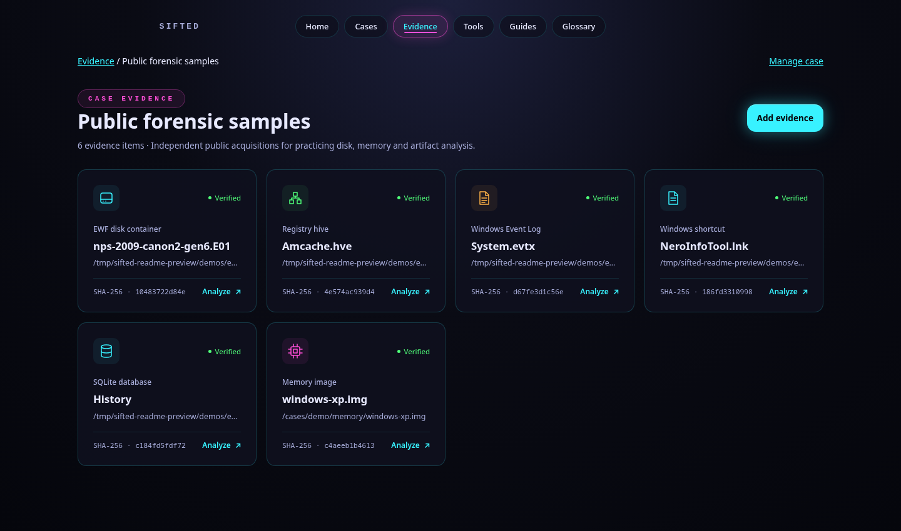
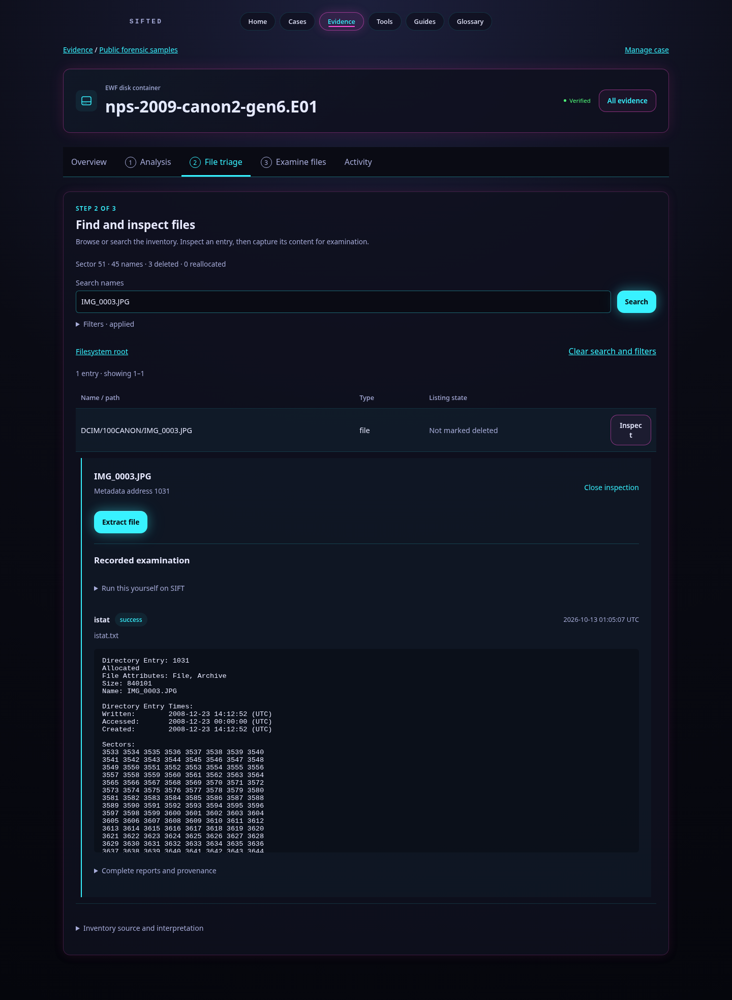
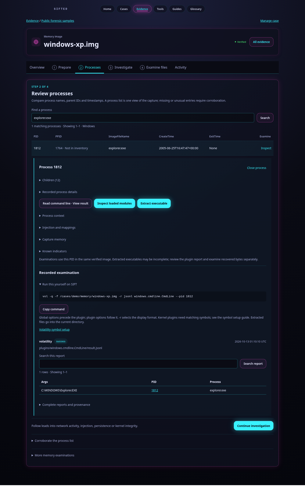
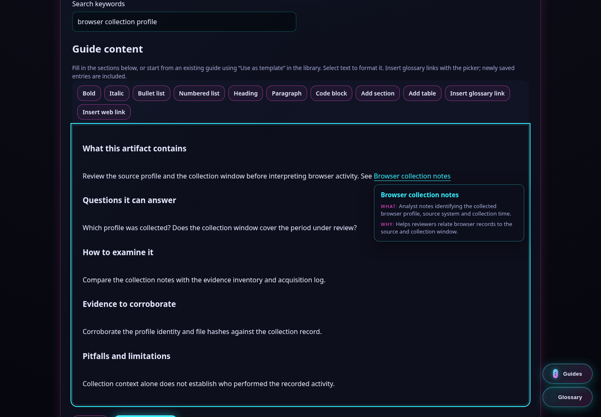
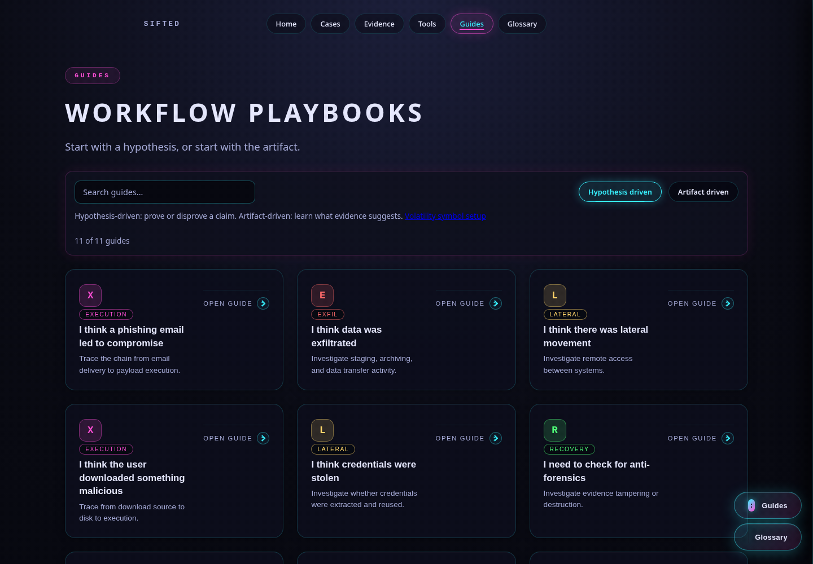
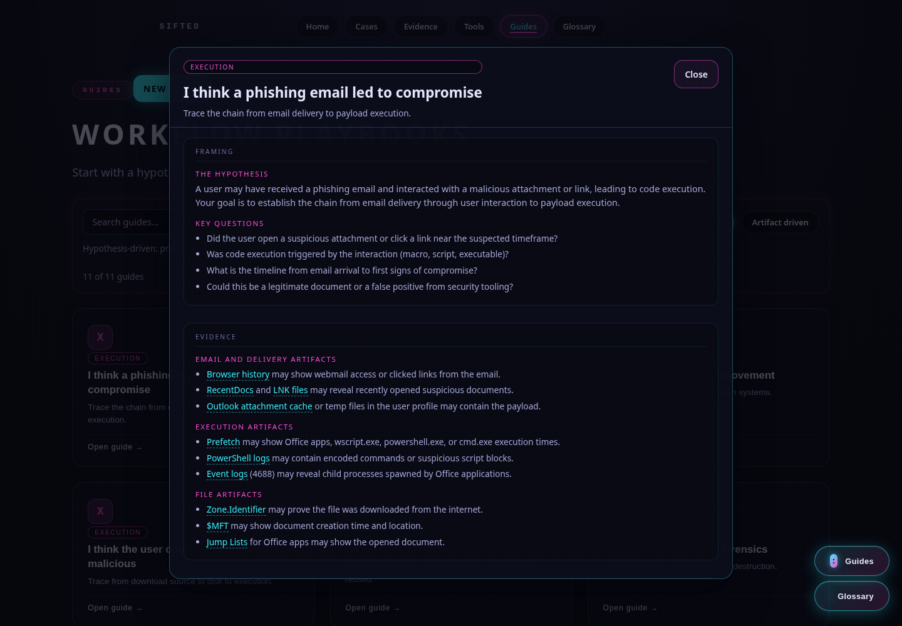
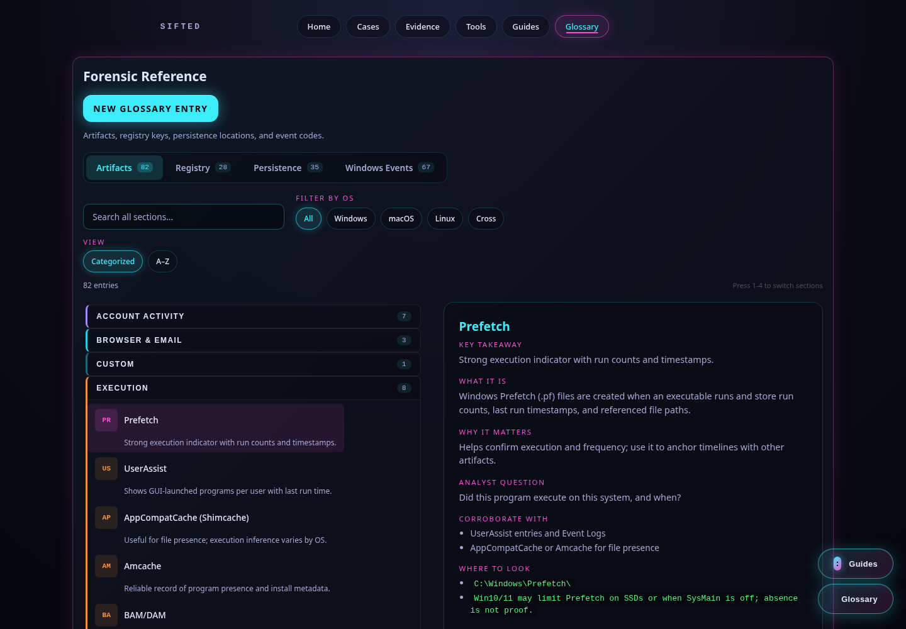

```
!!! Full transparency; this application is largely developed with assistance from Codex.
!!! If you are a member of the larger Digital Forensics community, I'd love to collaborate and get it in front of a legitimate development team!
``` 

# SIFTed

SIFTed is a web interface for digital forensics on a SIFT Workstation, built to help analysts move from evidence to reviewable results. Create a case, upload files or register workstation paths, and let SIFTed hash and identify the evidence before analysis. The evidence workspace guides disk investigations through partition mapping, filesystem inventory, file inspection and recovery. Memory investigations use Volatility 3 to identify captures, review processes and parent–child relationships, investigate network activity and injection, and examine recovered files.

Available workflows include Windows artifact parsing with Eric Zimmerman tools, file carving with Foremost and Scalpel, feature extraction with Bulk Extractor, timelines with Plaso, and file examination with strings, ExifTool, hex views and PDF utilities. Memory examinations include a bundled YARA rule library; captured files can be scanned with local ClamAV signatures. Results stay with their case, alongside logs, input hashes and output manifests, and recovered files can feed subsequent examinations. Copyable native terminal commands, investigation guides and a searchable glossary help analysts understand and reproduce the work. [Public demonstration evidence](demos/README.md) provides practice samples with known findings.

## Install on your SIFT Workstation

Install and run SIFTed **directly inside your SIFT Workstation**, where the forensic tools and evidence are accessible. In a SIFT terminal, use Git and Python 3.11+ with `venv` support to clone the repository and install its Python dependencies. The example below creates evidence and results directories in your home folder; change those paths to suit your case storage. SIFTed uses the workstation's installed forensic tools; `setup` installs only the application's Python dependencies.

```bash
git clone https://github.com/timgrady92/SIFTed.git
cd SIFTed
./sifted setup

mkdir -p "$HOME/sifted-cases/evidence" "$HOME/sifted-cases/results"
export SIFTED_INPUT_ROOTS="$HOME/sifted-cases/evidence"
export SIFTED_OUTPUT_ROOTS="$HOME/sifted-cases/results"
./sifted
```

Open <http://127.0.0.1:5000> in the SIFT Workstation's browser, create a case, and add evidence. Keep the same directory settings when you relaunch; without them, both roots default to `/cases`. For tool configuration and memory prerequisites, see the [runtime documentation](docs/runtime.md), [memory analysis guide](docs/memory-analysis.md) and [symbol setup guide](docs/volatility-symbols.md).

## Evidence workflows

*Case workspace: six verified public samples, with evidence types and SHA-256 fingerprints.*



<details>
<summary>Disk triage: IMG_0003.JPG and its recorded filesystem metadata</summary>



</details>

<details>
<summary>Memory inspection: explorer.exe, its command line and a native Volatility command</summary>



</details>

## Guides and glossary

**Guides** provide searchable playbooks for starting with a hypothesis, such as suspected phishing or data theft, or with an artifact you need to understand. Each playbook connects investigative questions to evidence sources, corroboration, pitfalls, limitations and stopping points. **Glossary** is a searchable forensic reference covering artifacts, registry keys, persistence locations and Windows event codes, with operating-system filters, evidence locations and interpretation guidance. Open either from the navigation bar; contextual artifact links in the guides connect the playbooks to the reference material.

Create your own content with **New guide** or **New glossary entry**, or open existing content and choose **Use as template**. The shared editor supports structured reference fields, database and event tables, formatted guide sections, lists, code blocks and links. **Insert glossary link** includes entries you create after installation: hovering shows their current definition and clicking opens their reference. Saved content appears in the libraries and sidebars and persists on your workstation. See the [authoring instructions](docs/GUIDECREATION.md) for editing, previews and storage.

<details>
<summary>Guide editor: formatting controls and a tooltip for a newly created glossary entry</summary>



</details>

*Guides library: the Hypothesis driven tab is selected; the Artifact driven tab is available beside it.*



<details>
<summary>Phishing playbook: investigative questions and evidence sources</summary>



</details>

*Glossary: the Prefetch reference is open, with its purpose, corroborating artifacts and evidence locations.*


